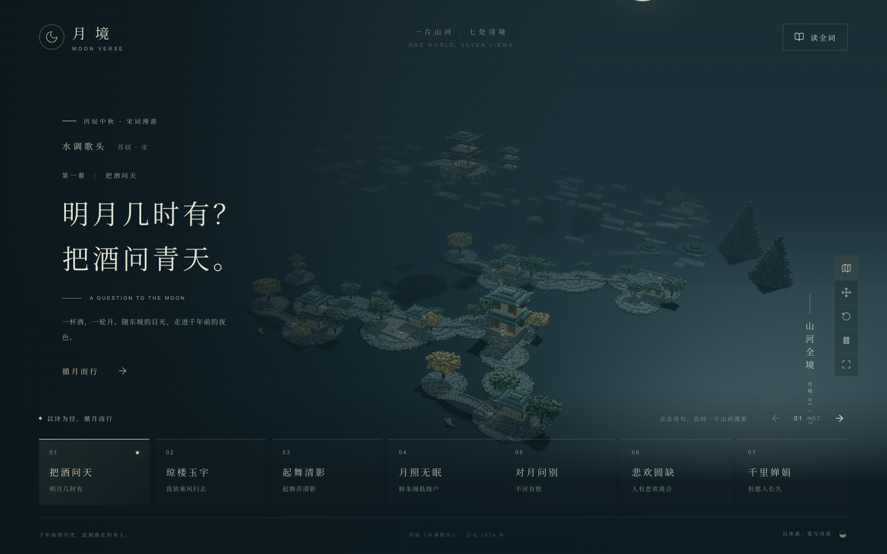
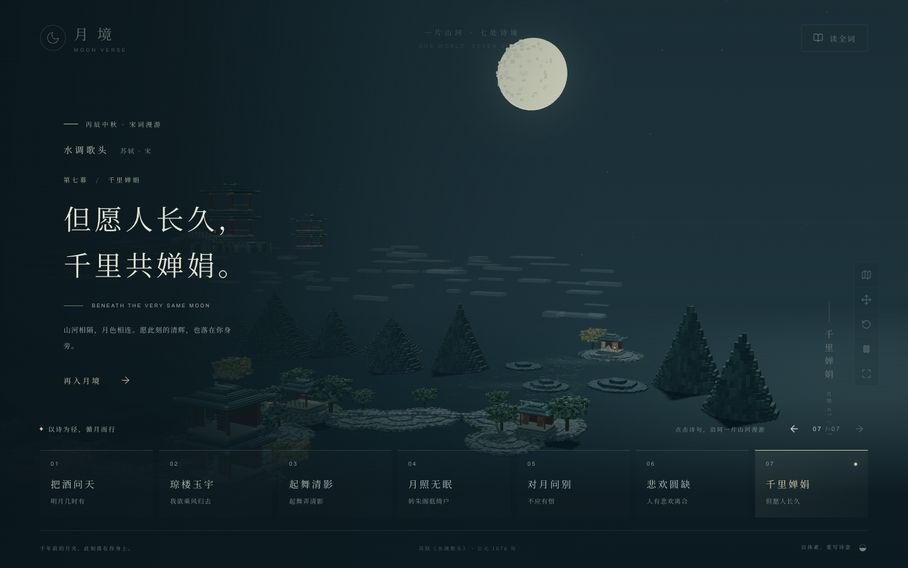

# 月境 · Moon Verse

把苏轼《水调歌头·明月几时有》做成一片可以漫游的 3D 月夜山河。沿着词句移动镜头，从「把酒问青天」走到「千里共婵娟」：七处诗境始终位于同一个世界里。


## 在月境里可以做什么

- **循诗漫游**：点击底部七句诗，镜头会沿湖岸与山水飞向对应地点；也可以用前后箭头依次游览。
- **俯瞰全境**：打开地图视角，看七处景观如何分布在同一片山河中。
- **自由观景**：拖动环顾、滚轮缩放，随时恢复该幕的推荐视角；还能暂停景物动态或切换全屏。
- **读完整首词**：打开「读全词」，点击任一段诗句即可前往对应场景。

| 俯瞰全境：七处诗境相连 | 末幕「千里婵娟」：镜头从临水近景缓缓拉远 |
| --- | --- |
|  |  |

「读全词」把原词与七处场景放在一起；诗句也可以作为导航入口。


## 本地运行

需要支持 WebGL 2 的现代桌面浏览器；建议窗口至少为 1024 × 740。

```sh
pnpm install
pnpm dev
```

打开终端给出的本地地址。构建和预览生产版本：

```sh
pnpm build
pnpm preview
```

## 部署到 GitHub Pages

在仓库的 **Settings → Pages → Build and deployment → Source** 中选择 **GitHub Actions**。提交并推送到 `main` 后，部署工作流会使用 pnpm 安装锁定的依赖、构建项目并发布 `dist`；也可以在 Actions 页面手动运行。

默认访问地址为 <https://echo-dm.github.io/moon-verse/>。Vite 的 `base` 已设置为 `/moon-verse/`；如果更改仓库名或使用根路径的自定义域名，需要同步修改 `vite.config.ts` 中的 `base`。

## 如何实现

项目使用 React、TypeScript、Vite 和 React Three Fiber / Three.js。山石、建筑、树木、人物与水面由程序化几何构成。七处景观共用地形、月亮和光照；切换诗句时移动镜头，而不是加载七个互不相连的场景。末幕会先停留在临水人物近景，再拉远呈现两岸与明月。

页面支持系统的「减少动态效果」设置。更多交互与验收细节见[验收记录](docs/acceptance.md)。
